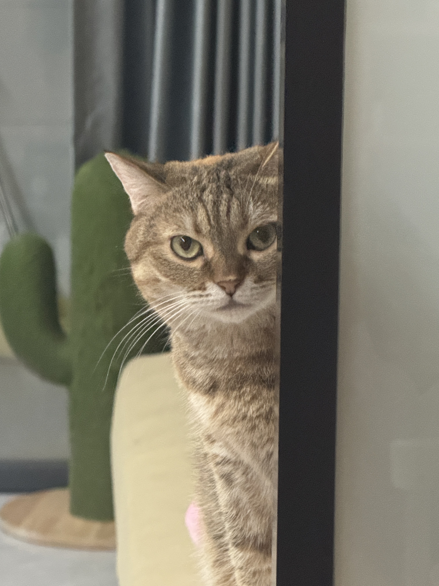
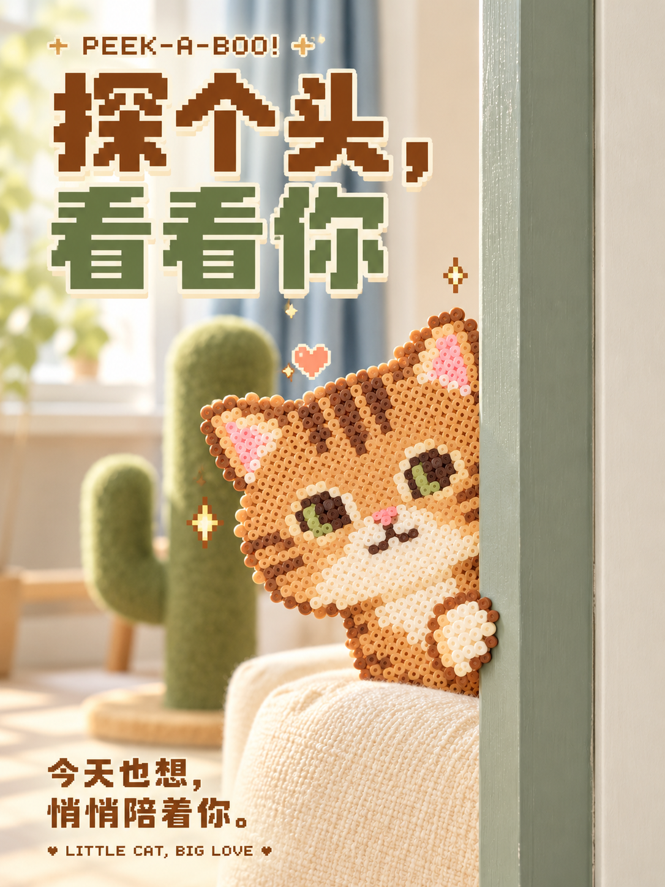
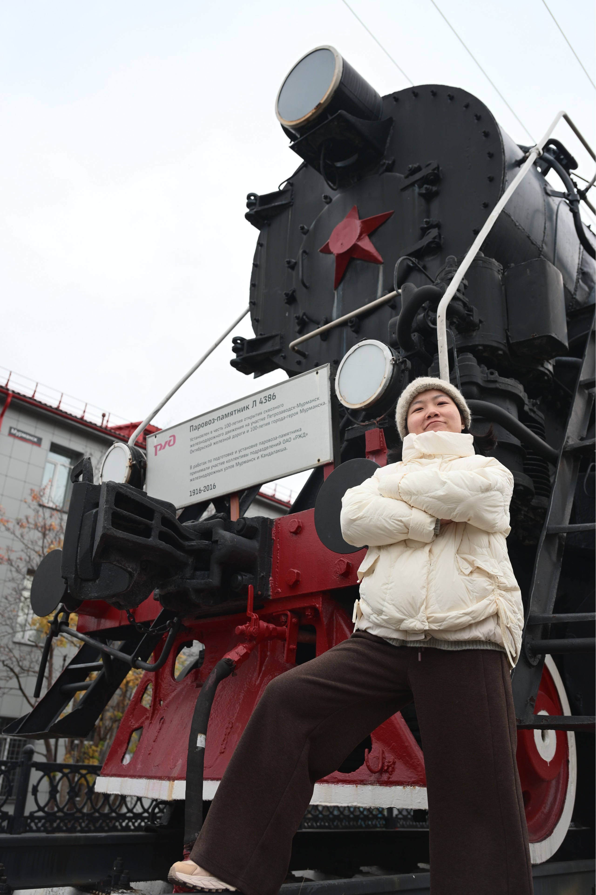
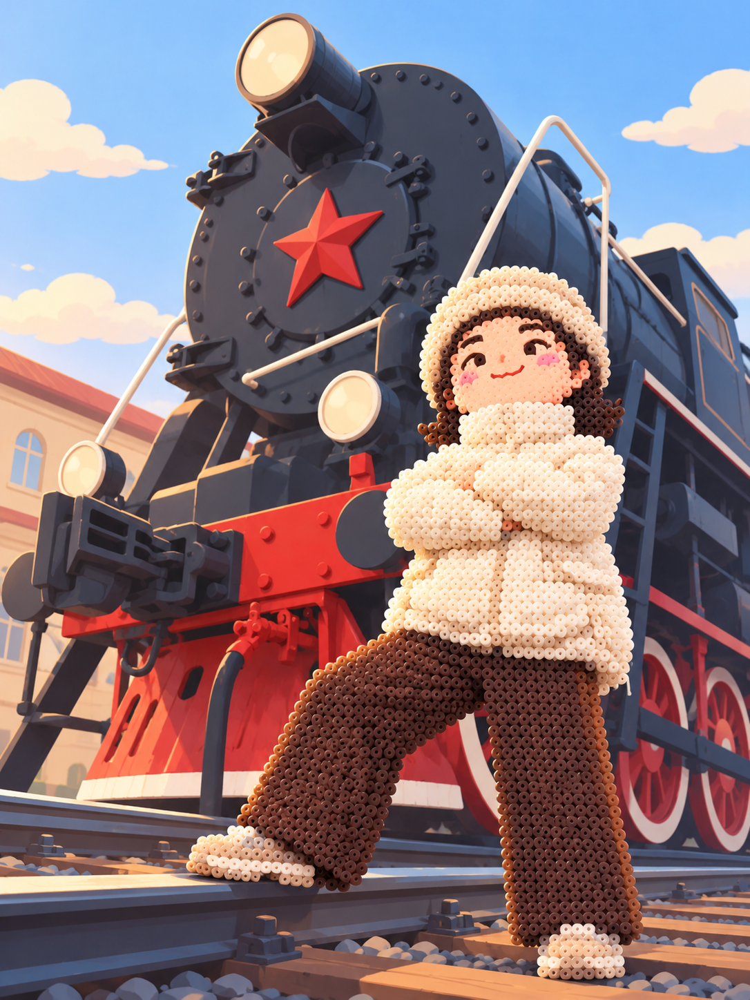
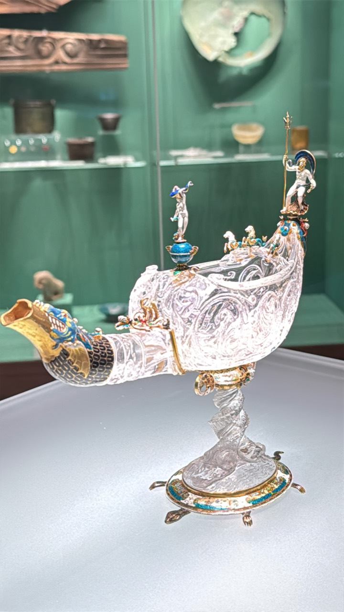
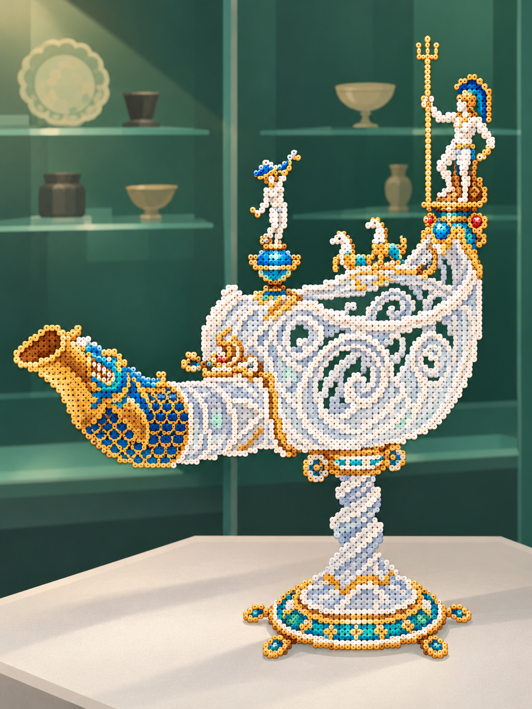
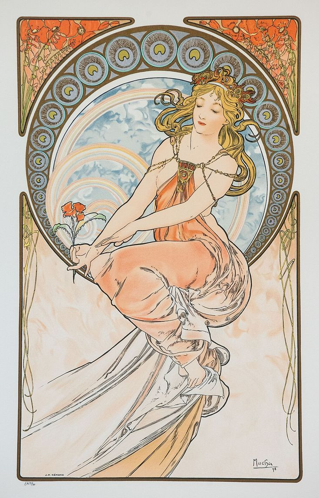
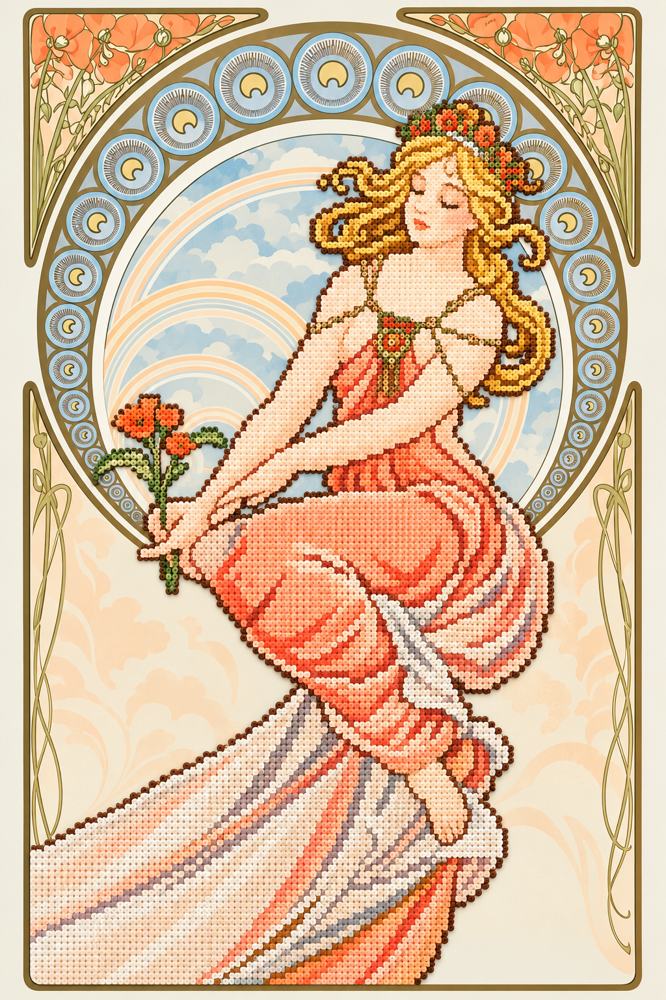

[中文](README.md) | **English**

# Perler Photo Art

Turn a subject from a photo or illustration into round, hole-centered perler bead art, paired with a smooth illustrated environment. Includes composition refinement and optional pixel-type posters.

[Gallery](#gallery) · [User guide](#user-guide) · [Full skill (Chinese)](SKILL.md)

## Gallery

Four selected before-and-after pairs, preserving the original files of the chosen versions. Inputs are on the left; generated results are on the right.

### 1. Peeking cat poster

| Input | Result |
| :---: | :---: |
|  |  |

A rounded face, compact body and simplified stripes create a friendly character, paired with pixel typography and small decorative accents. This early poster retains photographic background qualities. For new work, the skill defaults to a smooth illustrated background.

### 2. Steam locomotive portrait, V1

| Input | Result |
| :---: | :---: |
|  |  |

Preserves the crossed arms, raised leg, cream jacket and dark trousers while strengthening the composition. The selected V1 has a fuller bead texture. It illustrates a specific aesthetic choice; tasks requiring a strictly single-layer structure still follow the skill's flat-form rules.

### 3. Ornamental crystal vessel

| Input | Result |
| :---: | :---: |
|  |  |

Cream, ice blue, gold and open spaces suggest the vessel's structure, ornament and transparency. The setting is simplified into a dark green cabinet and a light display stand. Fine connections and cutouts are visual interpretations, without physical construction validation.

### 4. Art Nouveau figure

| Input | Result |
| :---: | :---: |
|  |  |

Retains the elongated seated pose, golden curls, coral dress and circular ornament. Color regions describe the figure and folds. The example shows continuity of proportion and decoration; background and border materials still require region-by-region checks in new work.

## User guide

### What it does

- Identifies the subject in the current input and preserves identity, pose, colors and recognizable structure.
- Converts selected subjects into regular, round, hole-centered perler bead graphics, separating overall flatness from the tactile surface of individual beads.
- Redraws the remaining scene as smooth color areas, flowing lines and soft graphic shadows.
- Refines cropping, scale, negative space and visual balance.
- Produces an image without added text by default. Explicit poster requests enable pixel typography and foreground elements grounded in the scene.

### Material regions

| Region | Content | Treatment |
| --- | --- | --- |
| A: bead subject | Specifically selected objects and parts | Regular, single-layer plastic beads with round holes |
| B: illustrated environment | Everything outside A, including background, foreground, supports, decoration, borders and gaps | Smooth 2D illustration without bead texture |
| C: typography | Explicitly requested titles, copy and layout graphics | Flat pixel typography and graphic elements |

A and B cover the entire content image without overlap. C is an optional overlay. Define these regions again for each new image, and include their object lists and boundaries in the actual image-generation prompt. Coordinate color, composition and lighting across the different materials.

### Installation and use

1. Download and extract the repository ZIP. Rename the extracted folder to `perler-photo-art`.
2. Place it in your agent's supported skills directory. Typical personal locations are `~/.codex/skills/perler-photo-art/` for Codex and `~/.claude/skills/perler-photo-art/` for Claude Code. Follow your platform's actual configuration.
3. Attach a photo or illustration and ask the agent to use `perler-photo-art`.

Agents that support skill-file imports can load `SKILL.md` directly. For chat-only interfaces, paste its full contents as instructions and attach the current image. All operating rules, Chinese prompt templates, case descriptions and review criteria are embedded in the file. No external document links are required, and example images are optional.

For a text-free result, ask the agent to select the bead subject, redraw the remaining scene as smooth illustration, preserve the main pose and refine the composition. For a poster, also specify the exact title, copy and desired aspect ratio. The executable skill and copy-ready prompt templates are written in Chinese; this page provides the English documentation.

### Files and execution

- `SKILL.md`: complete Chinese instructions, material rules, templates, case descriptions and review criteria.
- `agents/openai.yaml`: Codex interface configuration.
- `examples/`: four before-and-after pairs, totaling eight image files.
- `examples/manifest.json`: SHA-256 checksums for the example images.

This skill defines a creative workflow and uses the image-generation or editing capabilities available in the host agent. A text-only agent returns a complete prompt. The gallery records selected exploratory results; the current written rules and the user's instructions govern new tasks. Physical bead construction requires separate grid, palette, bead-count and structural planning.
